# Microservices on Kubernetes (Minikube)

Four Node.js services deployed on Minikube: **user (3000)**, **product (3001)**, **order (3002)** and **gateway (3003)**.
Every Service is `ClusterIP`. The gateway reaches the other services through cluster DNS names
(`user-service`, `product-service`, `order-service`).

## Project layout
```
Microservices/
├── user-service/  product-service/  order-service/  gateway-service/   (app.js, package.json, Dockerfile)
└── submission/
    ├── deployments/   *-deployment.yaml
    └── services/      *-service.yaml
```

## 1. Prerequisites
Docker Desktop (running), `minikube`, `kubectl`.

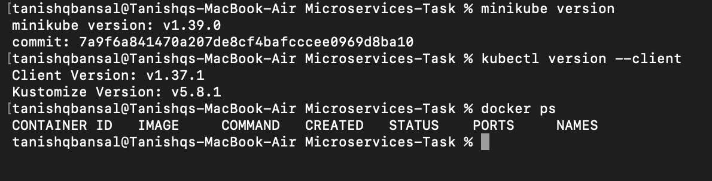

## 2. Minikube setup
```bash
minikube start --driver=docker --cpus=2 --memory=4096
minikube status
kubectl config current-context     # must print: minikube
kubectl get nodes                  # minikube   Ready
```
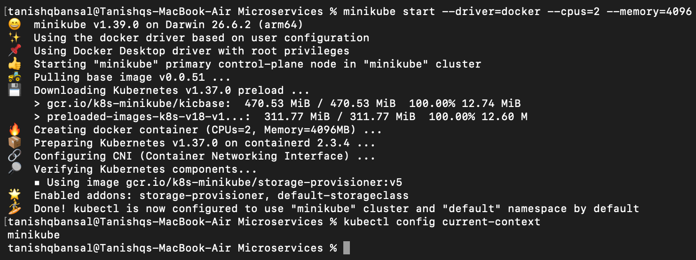
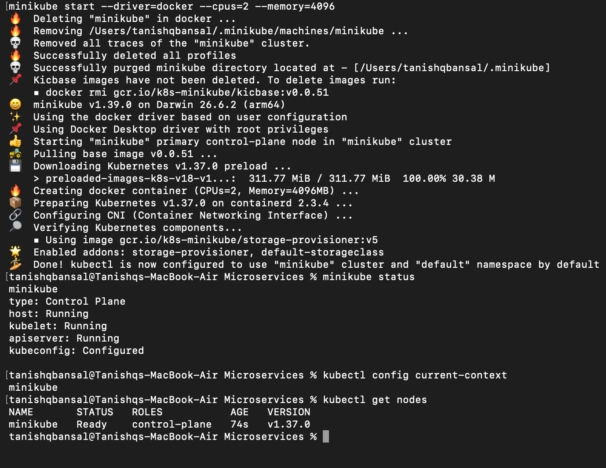

## 3. Build images and load them into Minikube
The manifests use `imagePullPolicy: Never`, so the images must exist inside the Minikube node.
Build them with Docker, then load them in:
```bash
cd Microservices
docker build -t user-service:1.0     ./user-service
docker build -t product-service:1.0  ./product-service
docker build -t order-service:1.0    ./order-service
docker build -t gateway-service:1.0  ./gateway-service

minikube image load user-service:1.0
minikube image load product-service:1.0
minikube image load order-service:1.0
minikube image load gateway-service:1.0
minikube image ls | grep service
```
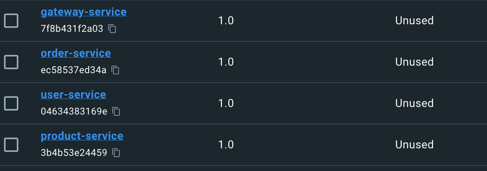
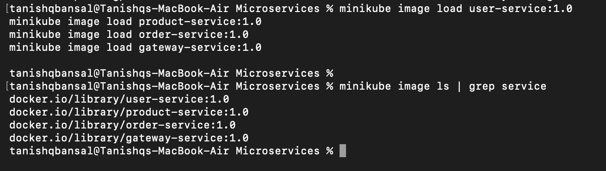

> `order-service/app.js` needed a fix: `orders` was never declared, so `/orders` threw a ReferenceError.
> The fix is `const orders = [];`.

## 4. Deploy
```bash
kubectl apply -f submission/deployments/
kubectl apply -f submission/services/
kubectl get pods
kubectl get svc
```
All four pods reach `1/1 Running`.

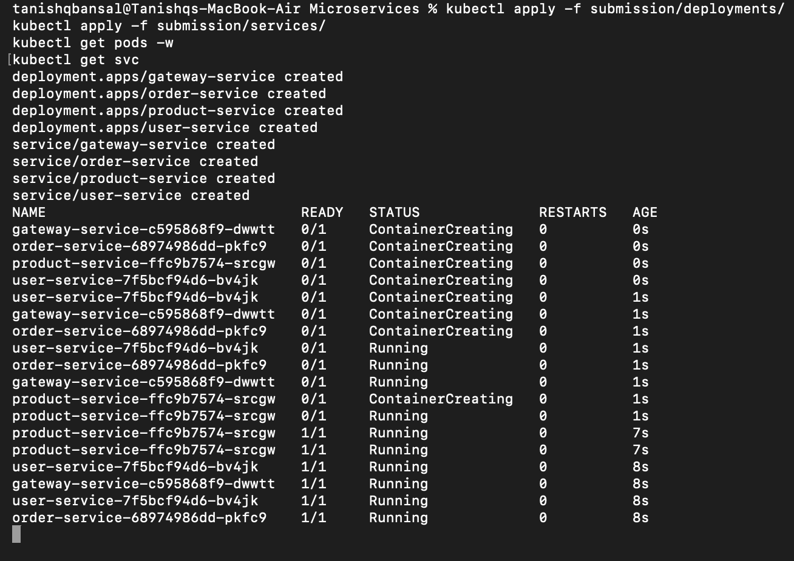

## 5. Test with port-forward
One terminal per command:
```bash
kubectl port-forward svc/user-service    3000:3000
kubectl port-forward svc/product-service 3001:3001
kubectl port-forward svc/order-service   3002:3002
kubectl port-forward svc/gateway-service 3003:3003
```

### 5.1 Each service directly
| Service | URL | Result |
|---|---|---|
| User | `localhost:3000/users` | 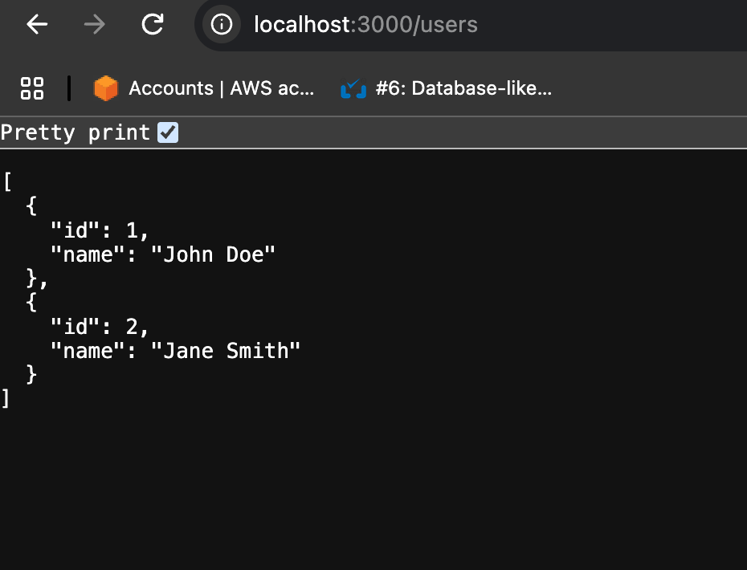 |
| Product | `localhost:3001/products` | 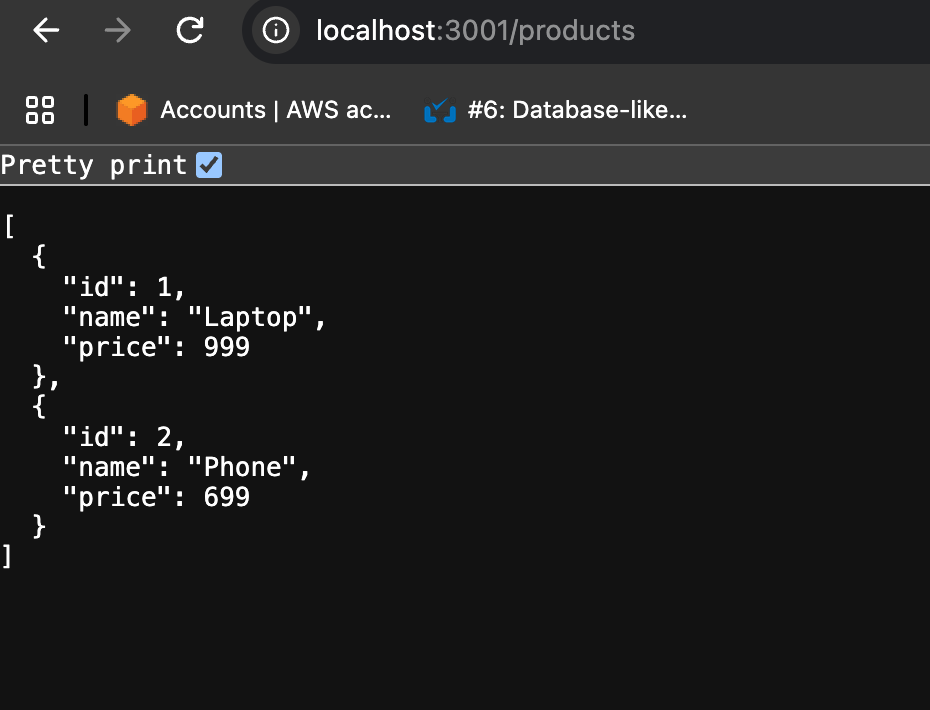 |
| Order (empty) | `localhost:3002/orders` | 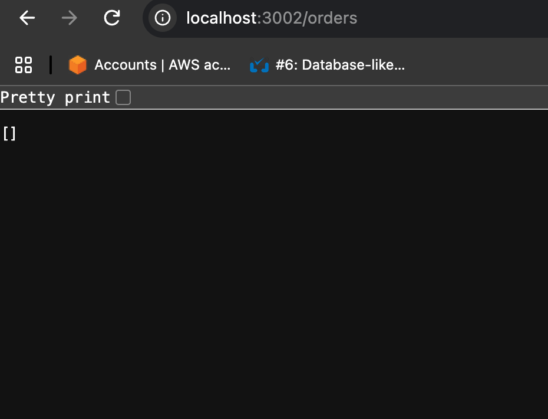 |

### 5.2 Through the gateway
```bash
curl localhost:3003/health
curl localhost:3003/api/users
curl localhost:3003/api/products
curl -X POST localhost:3003/api/orders -H 'Content-Type: application/json' -d '{"userId":1,"productId":2}'
curl localhost:3003/api/orders
```
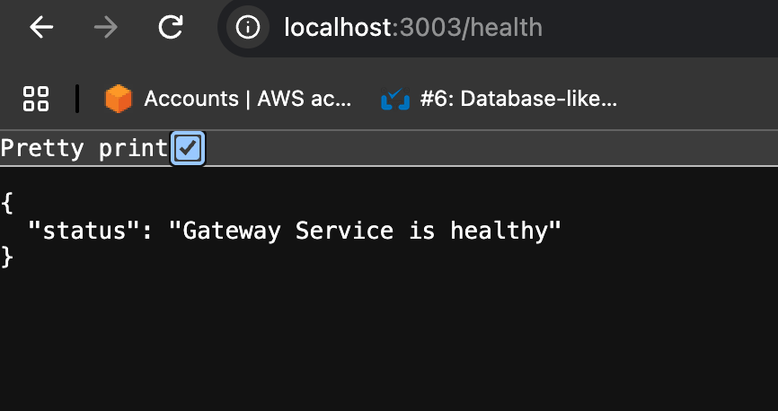
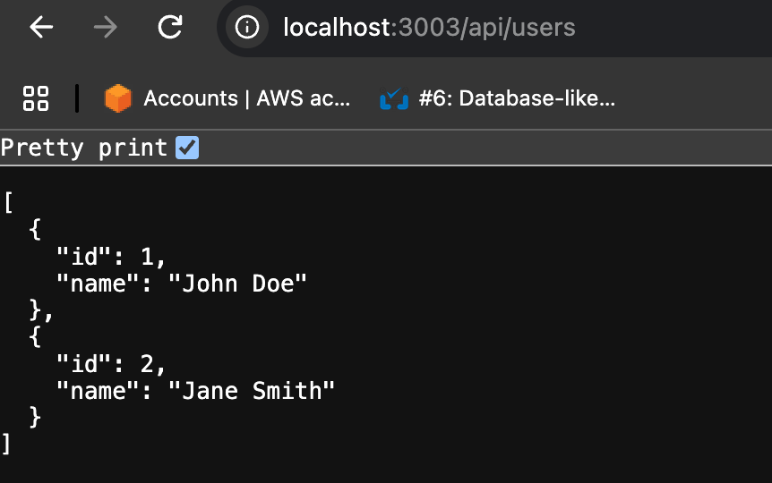
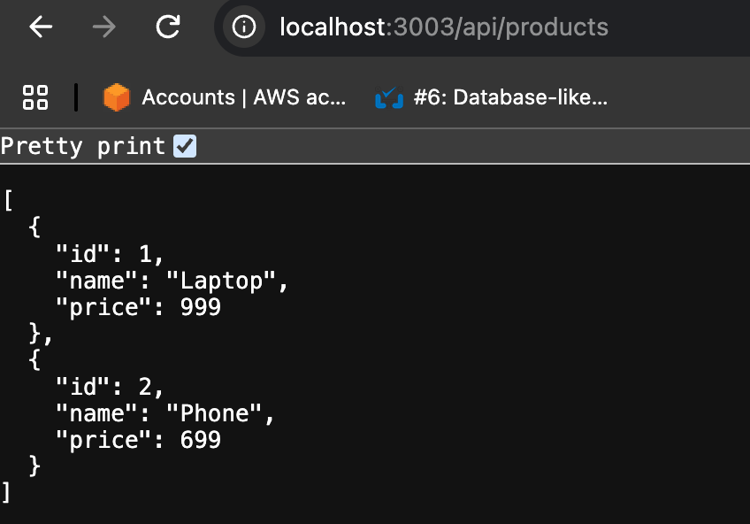
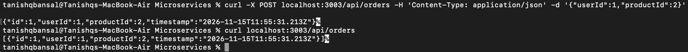

The order created through the gateway appears in the order service itself, so the gateway-to-order call worked:

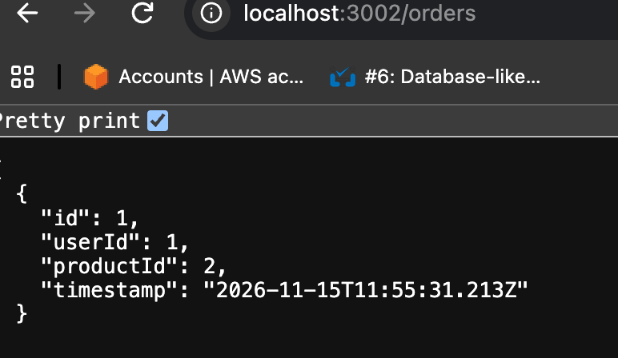

## 6. Inter-service communication from inside the cluster
```bash
kubectl exec deploy/gateway-service -- wget -qO- http://user-service:3000/users
kubectl exec deploy/gateway-service -- wget -qO- http://product-service:3001/products
kubectl exec deploy/gateway-service -- wget -qO- http://order-service:3002/orders
```
The gateway pod reaches all three services by Service name, which shows that DNS discovery works.

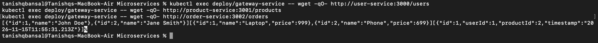

## 7. Logs
```bash
kubectl logs deploy/gateway-service
kubectl logs deploy/order-service
```
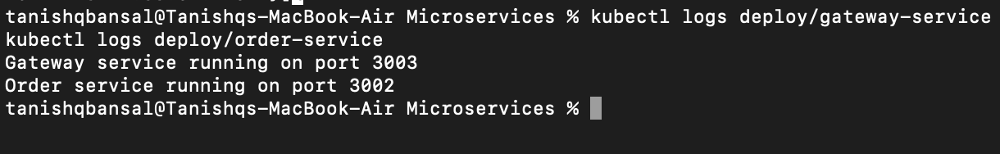

## 8. Troubleshooting (issues faced and fixed during deployment and testing)
| Symptom | Cause / fix |
|---|---|
| `failed to download openapi ... eks.amazonaws.com` | `kubectl` points at another cluster. Run `kubectl config use-context minikube`. |
| `connection refused` on `127.0.0.1:<port>` | Minikube stopped. Run `minikube start`, then `minikube update-context`. |
| `No such container: minikube` | Docker Desktop lost the container. Run `minikube delete --all --purge`, then `minikube start`, then reload the images. |
| `ErrImageNeverPull` | The image is not in Minikube. Run `minikube image load <name>:1.0` and `kubectl rollout restart deploy/<name>`. |
| Pod `0/1` Ready | Readiness probe failing. Check `kubectl describe pod <name>`. |
| Gateway returns `Error fetching ...` | Check `kubectl get svc` and `kubectl get endpoints`. |
| `address already in use` on port-forward | Stop the old port-forward or use another local port. |

## 9. Cleanup
```bash
kubectl delete -f submission/services/ -f submission/deployments/
minikube stop     # or: minikube delete
```